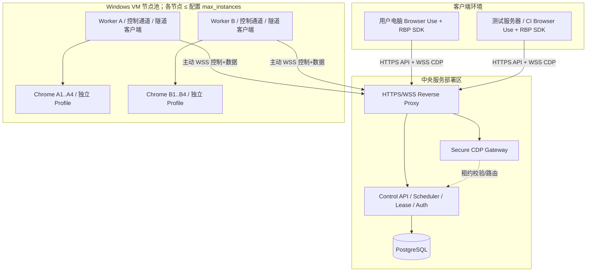
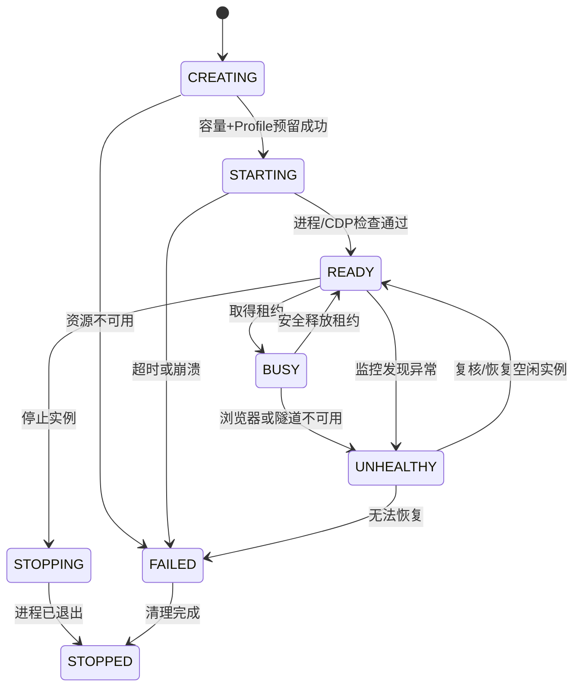
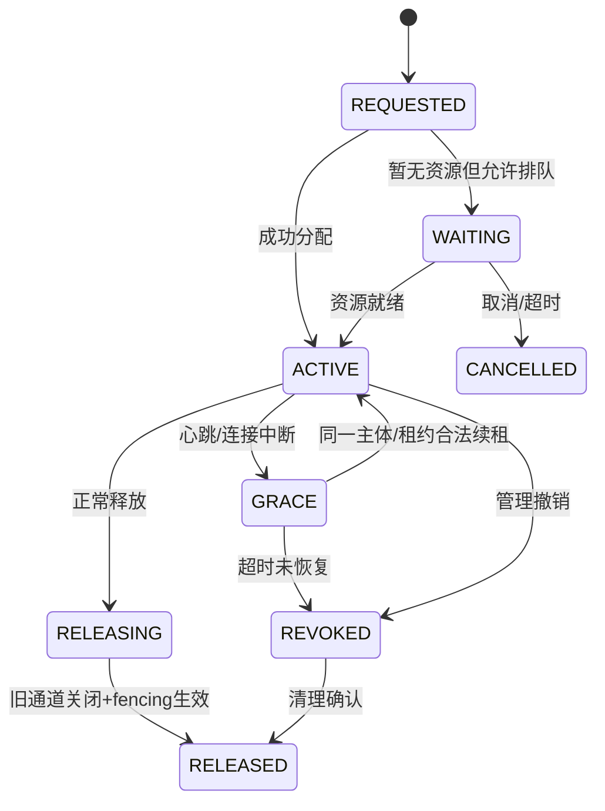
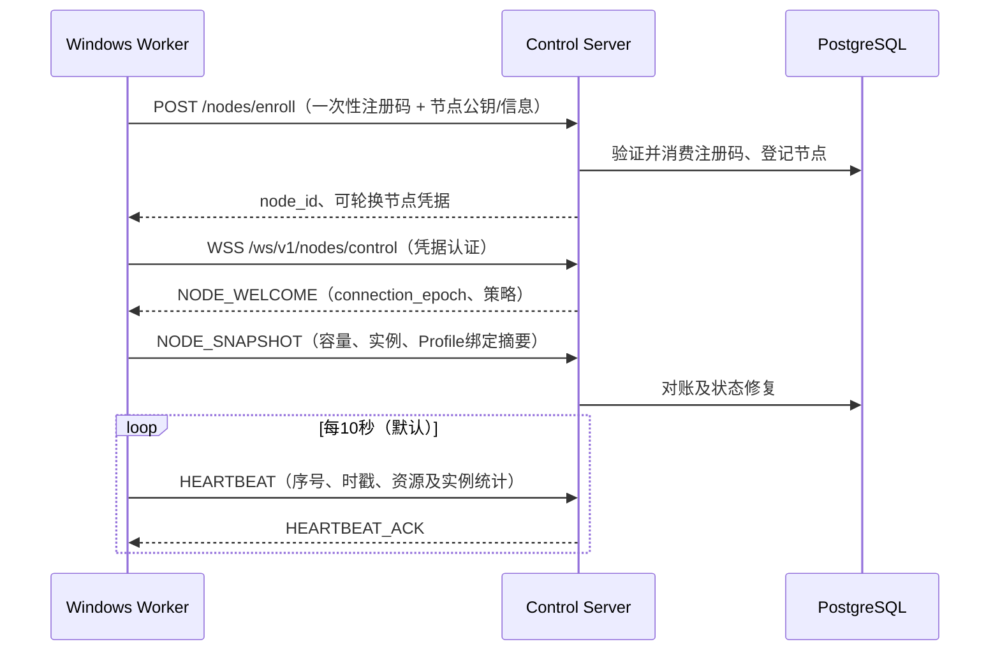
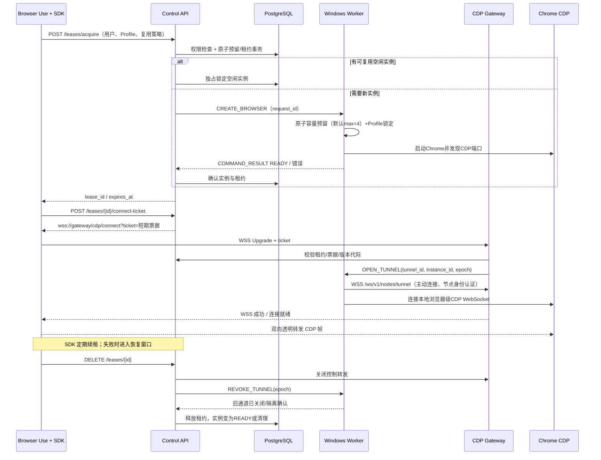
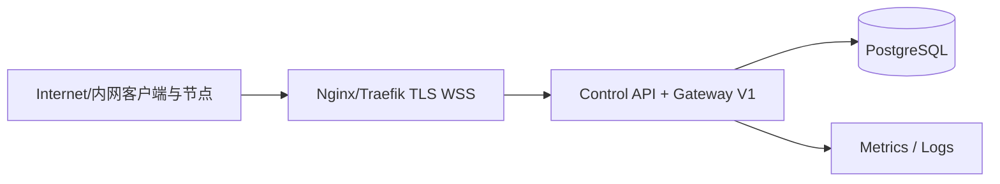

# Browser Use 远程 Windows 浏览器平台——总体架构设计说明书

> 文档版本：v1.0（设计基线）  
> 编制日期：2026-11-16  
> 项目代号：Remote Browser Pool（RBP）  
> 状态：总体架构方案；须经 PoC 与性能验证后实施  
> 配套文档：《02-详细需求规格说明书.md》

## 1. 项目背景与目标

建设一套**与 Browser Use Agent 解耦**的远程浏览器资源平台。Browser Use 1.0 系列可以运行在用户个人计算机、CI 主机或者专用服务器，真实浏览器统一运行在远程 Windows 虚拟机上；客户端只连接中央控制服务，不直接访问 Windows VM 的 Chrome 调试端口。

**已确认的设计约束：**

1. Windows 上使用 Chrome for Testing，**可见窗口（Headful）**；一期只操作网页，不操作原生 Windows 控件。
2. Windows 虚拟机允许人工通过 RDP 登录一次；用户会话保持，断开连接不等于注销。重启后允许再次人工登录。
3. 单节点 Chrome 实例数量**默认上限为 4**，通过节点配置设置，不是 Chrome 的技术限制。多节点目标支持至少 **20 个同时占用的浏览器控制会话**，容量规划按 **20+** 扩展。
4. 每个浏览器实例使用独立进程树、Profile、CDP 端点；Profile 支持持久化登录状态。
5. Windows Browser Service 采用 **Python + FastAPI + 原生 CDP**。Agent 不运行于 Windows 节点。
6. 设立独立的 **Browser Control Server**，负责资源调度、租约、鉴权、授权、管理、审计与 CDP 安全代理。
7. **Windows 节点主动建立**中央服务的 WSS/TLS 连接；无需开放 Windows VM 的公网入站服务或 Chrome CDP 端口。
8. 一期支持截图；浏览器页面实时回显、客户端人工接管纳入后续版本，预留能力边界。

### 1.1 项目不做什么

- 不开发浏览器内核、不代替 Browser Use 的 Agent 决策逻辑，也不托管用户大模型推理。
- 不承诺在同一浏览器实例上允许两个 Agent **同时独立控制**；一期为**单控制租约**。
- 不在一期实现原生 Windows 鼠标键盘操控、原生对话框自动化、桌面录屏或完整远程桌面。
- 一期不承诺像操作系统用户/VM 那样的**强租户隔离**：独立 Profile 是登录状态隔离，不是恶意租户的安全沙箱。
- 不承诺 Windows 注销、重启后仍保留浏览器进程；复原需重新登录和创建/恢复实例。

## 2. 技术选型与版本策略

| 层级 | 首选技术 | 设计原则 |
|---|---|---|
| 客户端 | Python 3.11+，Browser Use 1.0.x，RBP Python SDK（自研） | 用户本机/服务端均可运行，固定精确依赖版本 |
| 中央管理 | Python 3.11+/FastAPI/Pydantic/SQLAlchemy/Alembic | 对外 API、用户与租约、调度；单逻辑写入权 |
| 中央持久化 | PostgreSQL | 节点、实例影子记录、Profile 权限、租约、审计 |
| 节点控制通道 | WSS（Node → Control） | 单节点逻辑控制连接，心跳/命令/回执 |
| CDP 数据通道 | WSS（Client → Gateway；Node → Gateway） | 按客户端连接建立一对一字节/帧透明双向转发 |
| Windows Worker | Python/FastAPI/Uvicorn 单进程、psutil、httpx、websockets、pywin32（按需） | 在交互式登录会话运行；本机管理 API 仅绑定 loopback |
| 节点持久化 | SQLite | 本地实例状态、Profile 绑定、启动恢复/对账 |
| 浏览器 | 固定版本 Chrome for Testing（Stable） | 独立 `--user-data-dir`、动态 CDP 端口、GUI |
| 中央部署 | Docker Compose + HTTPS 反代 | V1 单实例 Gateway；水平扩容需要会话路由设计 |
| 观测 | 结构化日志、Prometheus metrics（可集成） | 分离控制/数据指标，不记录 CDP 敏感正文 |

**Browser Use 版本核验：**截至 2026-11-16 官方 GitHub Releases 显示 1.0.6。首个 PoC 以 `browser-use==1.0.6` 作为验证候选，验收后冻结精确版本；后续升级需跑兼容性回归。`Browser(cdp_url=...)` 为官方提供的远程接入方式；1.0 MIGRATING 文件明确说明该连接目前不能依赖自定义 WebSocket 握手 `headers`，所以需使用短期连接票据/受保护 WSS URL 或其他无需自定义 Header 的连接方法。

## 3. 总体部署拓扑



**流量方向必须明确：**
- 客户端主动访问中央 HTTPS 与 WSS；只接触经过鉴权和租约授权的 CDP 入口。
- Windows Worker 主动连接中央节点控制 WSS；**建立浏览器数据通道时也由 Windows 主动发起独立 WSS**。
- Chrome CDP 绑定 `127.0.0.1`；中央服务永不直接连接 Windows VM 的 Chrome 端口。
- V1 不需要开放任何 Windows VM 的外部入站端口。

## 4. 组件职责与边界

### 4.1 RBP Client SDK（用户端）
- `acquire(profile_id?, reuse?, wait_timeout?)`：申请并独占浏览器，透明等待/重试可用节点。
- `get_connect_ticket(lease_id)`：领取短期 WSS 连接票据；不暴露原始本地 CDP。
- `renew(lease_id)`、`release(lease_id)`：租约续期/释放；后台续租支持异常回收。
- 将 `wss://control.example/cdp/connect?ticket=...` 传给 `Browser(cdp_url=...)`。
- 客户端退出必须在 `finally` 尝试释放；服务端不能依赖客户端主动释放。
- **SDK 不是 Agent**；不决定测试步骤，不处理模型 API Key。

### 4.2 Browser Control Server（中央管理）
- 节点准入与身份认证：一次性 enrollment；正常运行使用可轮换节点凭据。
- 节点注册/心跳/失联判定；节点状态 `ONLINE / DEGRADED / OFFLINE / DRAINING`。
- 实例调度：先复用满足权限和 Profile 条件的空闲实例，再在空余容量节点新建，最后排队或返回繁忙。
- 使用 PostgreSQL 事务/唯一约束完成租约独占、调度预留与幂等处理。
- 管理用户与 Profile ACL、节点角色、API Key、审计、配置策略。
- 通过请求关联 ID 向 Worker 下发创建/停止/探测实例等命令；命令结果可去重。

### 4.3 Secure CDP Gateway（中央代理）
- 提供 Browser Use 可连接的 **浏览器级 CDP WSS** 入口；不把 Chrome 的 127.0.0.1 端口开放出去。
- 按 `lease_id` 验证控制租约、用户、节点和短期票据；短期票据**只用于建连**，连接寿命由租约决定。
- 请求 Worker 建立对应 `tunnel_id`，接受 Windows 主动创建的数据通道，然后转发双向 WebSocket 消息。
- 以连接为单位限速/缓冲/背压/超时/关闭，原则上不解释或修改 CDP JSON 内容。
- **V1 不实现 WebSocket 多路复用。** 一个客户端 CDP WSS 对应一条节点主动连接的数据 WSS，便于定位和回收。
- V1 同一浏览器最多一个可写控制通道；只读截图由独立授权 API 提供，不开放观察者的原生 CDP。

### 4.4 Windows Browser Service（节点）
- 在 `browser-runner` 的交互式会话中运行，Windows 任务计划程序在用户登录后启动。
- 本机 FastAPI 管理接口仅绑定 `127.0.0.1`，远程管理使用 Worker 主动 WSS 控制通道。
- 以单进程 Instance Manager 管理 Chrome 生命周期；使用 SQLite/本地锁持久化 Profile 绑定和实例记录。
- 启动时预留容量与 Profile 独占锁，调用 CfT，读取 `DevToolsActivePort`，通过 `/json/version` 验证 browser WS。
- 检查存活 Chrome 进程树、CDP 可用性；恢复 Worker 重启后存活的实例；异常 Chrome 标记并按空闲/忙碌策略恢复。
- 默认 `max_instances: 4`，动态配置但需受限、安全生效；节点端为**最终物理容量校验点**。
- 对中央建立的 `OPEN_TUNNEL` 需验证有效租约代际（fencing epoch），旧代际通道不得继续控制。

### 4.5 Chrome for Testing
- 每实例专用 `user-data-dir`、临时/持久 Profile、独立下载目录和日志。
- `--remote-debugging-port=0`，读取实例 Profile 的 `DevToolsActivePort` 发现端口；检查实际监听只在 loopback。
- 不在多个 Chrome 主进程之间复用同一个正在使用的 Profile。
- 截图基于 CDP `Page.captureScreenshot`；页面目标基于 Target 发现/管理。

### 4.6 管理界面（V1 最小可用）
- 节点清单/详情：在线、版本、容量、CPU、RAM、实例数量、Drain 状态。
- 浏览器清单/详情：实例、Profile、租约、Chrome 版本、健康状态、最近错误、截图授权操作。
- 管理员操作：启/停调度、查看与撤销租约、停止空闲实例、配置节点上限/策略。
- 复杂仪表盘和 V2 实时画面播放器可以后续增强。

## 5. 模型定义与资源归属

| 实体 | 身份 | 重要规则 |
|---|---|---|
| Node | `node_id` | 注册后唯一，不可由客户端随意冒用 |
| Windows Session | `windows_session_id` | 与 Windows 登录会话相关；注销则浏览器全不可用 |
| Browser Instance | `instance_id` | 正在运行的 Chrome；实例占用一个节点容量名额 |
| Profile | `profile_id` | 持久 Cookie/配置；同一时刻最多绑定一个运行实例 |
| Browser Target | `target_id` | Chrome 中的页面/tab，截图需要明确目标 |
| Lease | `lease_id` + `epoch` | 给予一个主体在一个时间段的独占控制权 |
| Tunnel | `tunnel_id` | 客户端 WSS 与节点 WSS 的一对一转发会话 |
| User/API Client | `principal_id` | 绑定访问权限与审计记录 |

**重要区分：**`4` 限制的是**同时运行的 Browser Instance**，不限制保存的 Profile 数量，也不限制中央排队请求数。`READY` 但空闲的 Chrome 仍占用一个容量名额。`BUSY` 是租约占用状态，不增加实例数。

### 5.1 Browser Instance 状态机



容量占用按**实际资源是否未释放**判断：创建中、启动中、准备就绪、忙碌、异常但进程仍可能存活、停止中均计入；只有确认进程和 Profile 锁释放后才释放名额。

### 5.2 Lease 状态机



**租约先收回控制通道、并由节点确认隔离旧控制权，再允许重新分配浏览器。** 仅在数据库把 `ACTIVE` 改为 `EXPIRED` 不足以防止旧 Agent 继续操作。

## 6. 控制链路协议设计

### 6.1 节点注册及启动



控制消息封装统一字段：

```json
{
  "protocol_version": "1.0",
  "type": "CREATE_BROWSER",
  "message_id": "msg-uuid",
  "request_id": "req-uuid",
  "node_id": "node-uuid",
  "connection_epoch": 12,
  "sent_at": "2026-11-16T08:00:00Z",
  "deadline_at": "2026-11-16T08:00:30Z",
  "payload": {"profile_id": "profile-uuid", "profile_mode": "persistent"}
}
```

协议消息至少包括：`NODE_HELLO`、`NODE_WELCOME`、`NODE_SNAPSHOT`、`HEARTBEAT`、`HEARTBEAT_ACK`、`CREATE_BROWSER`、`STOP_BROWSER`、`GET_BROWSER`、`OPEN_TUNNEL`、`CLOSE_TUNNEL`、`SCREENSHOT`、`COMMAND_RESULT`、`ERROR`。

- `message_id` 用于接收方去重，`request_id` 用于请求/应答关联。
- 节点重新连接会递增 `connection_epoch`，旧连接不能继续执行命令。
- 命令具有 deadline、结果状态和幂等键；超时不等于命令未被执行，必须查询/对账。
- 节点以最新连接认证成功并完成 snapshot 对账后才标为可调度。
- 心跳默认 10s，失联阈值默认 35s，重连指数退避带抖动。均为可配置初始值。

### 6.2 浏览器申请、创建与代理连接



**实现注意：**浏览器级 WebSocket 通常形如 `/devtools/browser/{guid}`。V1 直接提供 `wss://.../cdp/connect?ticket=...` 的浏览器级透明 WebSocket（不是 Playwright 专属协议），不要求 Browser Use 先进行匿名 HTTP `/json/version` 发现。可扩展版本如需 HTTP discovery，则额外实现经鉴权的 JSON discovery 与地址改写。

### 6.3 隧道配对和防冒用

- 中央 Gateway 为每次连接生成 `tunnel_id`、`lease_epoch`、`node_connection_epoch` 与强随机一次性 `tunnel_nonce`。
- 向**已认证的节点控制连接**下发 `OPEN_TUNNEL`；节点随后**主动** WSS 接入 Gateway，携带节点凭据及一次性 `tunnel_nonce`。
- Gateway 校验 `tunnel_id`、节点身份、实例归属、租约代际、有效期及一次性使用状态，然后将两条 WSS 配对。
- Node 只在本机将 `instance_id` 映射为真实 CDP port/guid，拒绝客户端提交任意目标 IP、端口或文件路径，防止 SSRF/代理穿透。
- 控制隧道终止时 Gateway 和 Node 均释放相关通道；撤销动作不依赖客户端善意退出。
- WebSocket 应有帧大小、缓冲限制和背压机制；网关不保存完整的 CDP 消息正文。

## 7. 调度及容量算法

**策略：先授权、再复用、再创建、最后排队。**

1. 校验用户请求可使用的 Profile（归属与 ACL）；匿名请求分配临时 Profile。
2. 过滤 `ONLINE` 且未 `DRAINING` 的节点、浏览器版本/标签/网络环境满足要求的节点。
3. 优先寻找 `READY` 且没有活动租约的兼容实例；复用必须保证 Profile 访问授权。
4. 没有可复用实例时，选择 `used_instances + reserved_instances < effective_max_instances` 的节点；有效上限为节点配置与中央策略上限取较小值。
5. 中央数据库原子预留创建权，Worker 再执行本地原子容量预留和 Profile 独占锁。
6. 节点告知容量冲突或资源不足时，中央尝试其他节点；都无资源时根据 `wait_timeout` 排队或返回 `RESOURCE_EXHAUSTED`。
7. 同一 Profile 只绑定一个运行实例，**不跨 Windows 节点并发挂载同一个 Profile 目录**。

额外建议设置 `max_cpu_percent`、`min_free_memory_mb` 等软准入阈值，但不能将固定内存估算当作事实；须经真实页面压测确定。

**容量计算示例：**6 节点×4=24 理论实例，可覆盖 20 个并发任务并留 4 个空位；若要求“一台节点故障后仍有超过 20 实例容量”，建议至少 7 节点×4=28，失去一台仍为24。这是数学容量而非性能 SLA，资源尺寸需要压测。

## 8. 认证、授权与安全边界

| 主体 | 凭据及边界 | 最小权限 |
|---|---|---|
| 管理员 | 管理控制台登录/管理员 Token | 节点和用户管理、审计、强制回收 |
| 普通客户端 | 有作用域的 API Key / OIDC（可选） | 只访问有权限的 Profile、申请和释放本人租约 |
| Windows Node | 注册令牌一次性消费，长期节点凭据定期轮换 | 仅上报本人节点、执行中央授权的管理指令 |
| CDP 客户端 | 一次性短期连接票据，绑定单一租约/实例 | 在租约有效期内控制指定浏览器 |
| Viewer（V2） | 单独的观看授权 | 只能获取编码页面帧，不能直接连接原始 CDP |

关键安全要求：
- 所有公网/跨网请求均使用 TLS；生产禁止 HTTP、WS 明文。节点的密钥在 Windows 用户安全存储或 DPAPI 中保护，中央仅存储哈希/加密后的凭据。
- Chrome CDP 永不开放公网或内网；本机 loopback 也属于高权限管理接口，须限制使用者。
- CDP 可读取页面、Cookie 与登录状态，**无字段级只读保证**。租约唯一、最小可达面及审计非常重要。
- Profile 属于用户/项目，默认**私有**；跨用户复用需要明确 ACL 授权，匿名池在租约后必须清理。
- 单台 Windows 同一交互式用户下多个 Profile 是逻辑隔离，不适合相互不信任的恶意租户。此类需求应拆分 Windows 用户或 VM。
- Browser Use 1.0 Agent 具有代码执行/网络访问能力；它在**客户端执行**，中央浏览器平台不会因此自动成为模型代码沙箱。测试账号与页面输入必须按照可信边界管理。
- 任何日志、trace、截图、下载文件可能包含隐私或密钥，统一制定最小采集和保留策略；连接票据和 CDP payload 禁止落入普通访问日志。
- 服务器限制 API 请求频率与连接数，阻止任意端口映射和客户端指定 CDP 目标。

## 9. 截图、页面回显与文件

### V1 截图
- 支持指定 `instance_id` + `target_id` 的视口 PNG 截图；按需支持整页但应有尺寸限制。
- 截图由 Node 访问本机 CDP，中央 API 以授权方式转发图片或存储证据；截图权限与控制租约独立。
- 对忙碌实例只允许对指定 Target 的非破坏性截图，不发送 `bringToFront`、导航等操作；需验证额外 CDP 连接是否与 Browser Use 冲突。
- 结果携带 `captured_at`、浏览器/Target/租约或授权上下文及图片内容哈希。

### V2 页面实时回显
- 基于 CDP `Page.startScreencast` 的实验性页面帧事件（或经验证的替代方案），由 Node 编码/转发到专门的 Viewer Gateway；与 Agent 控制通道隔离。
- 页面回显**不是 Windows 桌面/Chrome 标题栏回显**，也不是 V1 的必要验收项。
- 按页 Target、观看者权限进行订阅；编码/限帧率/背压/脱敏与隐私提示单独设计。
- V2 人工接管需升级独占控制租约，旧 Agent 控制被 fencing 后才允许人工操作。

### 上传与下载
- 浏览器文件系统位于 Windows VM；客户端 SDK 不能假定浏览器下载的文件自动出现在 Agent 机器。
- V1 要求下载目录隔离与路径安全，不强制实现跨机文件传输。
- V1.1 增加受控上传/下载工件服务（校验大小、路径、权限、病毒与保留策略），并专项验证 Browser Use 文件上传 API 在远程 CDP 场景的表现。

## 10. 故障恢复与一致性

| 故障 | 默认行为 | 恢复原则 |
|---|---|---|
| 用户客户端退出 | 租约续期停止并进入 GRACE | 超时后撤销旧隧道、fencing，然后释放资源 |
| 用户—中央 WSS 断开 | 关闭该客户端数据通道，租约暂保留 | 同一主体在宽限期内重领票据重连 |
| Windows—中央控制通道断开 | 节点 `DEGRADED`、停止新调度 | 已有 Chrome 仍可能在运行；不能立即重分配 |
| Windows CDP 数据隧道断开 | 该连接失败，Agent 可能报错 | 可重建新的数据隧道，不能保证 Agent 断点续跑 |
| Windows Worker 崩溃 | 登录任务自动重启 | 扫描 SQLite + PID + Profile + CDP 重新认领 |
| Chrome 崩溃 | 记录 FAILED，忙碌租约失败 | 不自动重启忙碌实例；空闲实例按策略恢复 |
| Windows 注销/重启 | Chrome 全部不可用 | 等待人工登录；Profile 可持久化但任务不保留 |
| 中央 API 重启 | 节点/客户端长连接中断 | 节点重连并对账；租约存 PostgreSQL；旧通道重新建立即检查 epoch |
| 两次相同申请 | 使用请求幂等键 | 避免双实例/双租约 |
| 释放时的旧请求迟到 | 验证 lease epoch | 丢弃陈旧指令，不得再次获得控制权 |

对 `STOP_BROWSER` 的结果不得仅凭命令回执判断成功；要在节点确认 Chrome 进程退出且 CDP 已停止后完成容量释放。

## 11. 部署方案

### 11.1 中央服务（Docker Compose 逻辑）



- V1 可以单进程/单副本运行中央 API 与 Gateway，PostgreSQL 单独持久化；部署时配置代理 WebSocket Upgrade、超时、连接数和最大帧。
- HTTPS/WSS 使用有效证书；内网自签 CA 须明确安装到 Windows 节点/客户端的信任库。
- V1 不宣称中央服务高可用。V2 多副本需要解决 Node Control 连接归属、Gateway 路由、数据库锁、跨副本消息和 Drain 迁移问题。
- 中央服务不持有用户 LLM 凭据，不负责运行 Agent。

### 11.2 Windows VM

```text
C:\BrowserRuntime\
  bin\chrome-win64\chrome.exe
  service\  (Worker Python 包或 EXE)
  config\runtime.yaml
  profiles\<profile_id>\
  downloads\<instance_id>\
  logs\
  data\runtime.sqlite3
```

- 使用专用低权限 Windows 账号 `browser-runner`，登录后由 Task Scheduler `InteractiveToken` 启动 Worker。
- 浏览器保持 GUI 模式；会话断开仍在后台运行的表现必须实测，避免注销，按需要配置断开会话超时策略。
- 只允许 Worker 访问 Profile 目录；默认不接管用户日常使用的 Chrome Profile。
- Chrome for Testing 在版本升级前做页面兼容与 CDP 回归；升级不覆盖 Profile 原始数据。

### 11.3 配置示例

**Windows Worker：**
```yaml
runtime:
  node_id: windows-vm-01
  max_instances: 4
  profiles_root: 'C:\BrowserRuntime\profiles'
  data_dir: 'C:\BrowserRuntime\data'
  cpu_soft_limit_percent: 85
  min_free_memory_mb: 2048
browser:
  executable: 'C:\BrowserRuntime\bin\chrome-win64\chrome.exe'
  headless: false
  remote_debugging_address: '127.0.0.1'
  remote_debugging_port: 0
  window_width: 1280
  window_height: 900
server:
  local_api_host: '127.0.0.1'
  local_api_port: 8765
  workers: 1
central:
  url: 'wss://browser.example.com/ws/v1/nodes/control'
  heartbeat_seconds: 10
  reconnect_max_seconds: 60
  credential_file: 'C:\BrowserRuntime\data\node-credential.bin'
```

**中央：**
```yaml
service:
  public_base_url: 'https://browser.example.com'
node:
  offline_after_seconds: 35
scheduler:
  default_node_capacity: 4    # 首次默认，节点实报优先
  queue_when_full: true
  max_queue_wait_seconds: 300
lease:
  ttl_seconds: 120
  renew_every_seconds: 30
  reconnect_grace_seconds: 60
cdp_gateway:
  ticket_ttl_seconds: 60
  max_open_connections_per_lease: 1
  tunnel_connect_timeout_seconds: 15
  max_message_mb: 32
```

## 12. 性能、容量与可观测性

- 初始容量目标：至少 20 条**同时处于 ACTIVE 且有可用浏览器实例的租约**；推荐 6×4=24 做基础验证，若要求单节点故障后仍覆盖 20+，按 7×4 规划。
- 重点压测：Chrome 启动时间、Browser Use CDP 连接成功率、中央网关单连接内存/CPU/带宽、截图响应时间、页面加载时的 Agent 端到端延迟。
- 监控至少包含：在线节点数、节点心跳延迟、每节点 `used/max`、创建成功率、排队长度、ACTIVE 租约、失效租约、WSS 并发、隧道字节数、CDP 断线、截图失败、Profile 锁冲突和慢请求。
- V1 目标值（待压测调整）：健康节点识别 ≤35s；浏览器租约到期后旧通道在宽限期结束时被强制关闭；控制消息延迟与截图 P95 需要在约定 LAN/WAN 测试条件下基准化。

## 13. 交付与演进路线

| 阶段 | 目标 | 交付物 |
|---|---|---|
| P0 PoC | 验证 Browser Use 1.0.x 经过中央 WSS、Windows 主动隧道控制 Chrome | 端到端导航/截图、RDP 断开验证、协议测试报告 |
| P1 V1 | 多节点、Profile、4 实例限制、鉴权、独占租约、管理 API、截图、恢复、基础管理页 | 可部署系统、API 文档、单元/集成/故障用例 |
| P2 V1.1 | 工件上传下载、资源指标、管理体验、运维强化 | 工件 API、指标仪表板、部署自动化 |
| P3 V2 | 页面实时回显、观察者授权、人工接管、多 Gateway 扩容 | Viewer、会话控制权转换、多副本架构 |

## 14. 设计风险与必须验证的前置条件

1. Browser Use 1.0.x `Browser(cdp_url=wss://...)` 是否能完整完成多页 Target 操作，并在 Browser Use 的 Agent 生命周期中不关闭外部 Chrome。**必须 PoC**。
2. 经中央 Gateway 代理后，浏览器级 WebSocket 的 Target 发现、会话事件、长消息及连接重建是否兼容。**必须 PoC**。
3. Windows RDP 断开或锁屏后 CDP 网页截图与网页交互是否稳定。**必须 PoC**。
4. 一个可见 Windows 会话中并行四个 Chrome 的资源和窗口行为，以及 Chrome 强制退出/恢复时 Profile 锁与 Cookie 的一致性。**必须 PoC**。
5. 浏览器截图的并行观察连接是否影响 Browser Use 对同 Target 的操作。**必须 PoC**。
6. 网络断开、中央重启、节点重连时能否证明**不会把同一个浏览器控制权同时授予两个客户端**。**必须故障注入测试**。
7. 远程 Browser Use 上传/下载的路径语义存在版本和实现差异；不得在未验证前承诺文件双向无缝传输。

## 15. 资料与核验链接

- Browser Use releases: https://github.com/browser-use/browser-use/releases
- Browser Use 1.0 migration notes: https://github.com/browser-use/browser-use/blob/main/MIGRATING.md
- Browser Use source/README: https://github.com/browser-use/browser-use
- Chrome for Testing: https://googlechromelabs.github.io/chrome-for-testing/
- Chrome remote debugging security changes: https://developer.chrome.com/blog/remote-debugging-port
- CDP protocol: https://chromedevtools.github.io/devtools-protocol/
- CDP Page API（截图、Screencast）: https://chromedevtools.github.io/devtools-protocol/tot/Page/
- Windows interactive services: https://learn.microsoft.com/en-us/windows/desktop/services/interactive-services
- Task Scheduler logon types: https://learn.microsoft.com/en-us/windows/win32/taskschd/taskschedulerschema-logontype-principaltype-element
